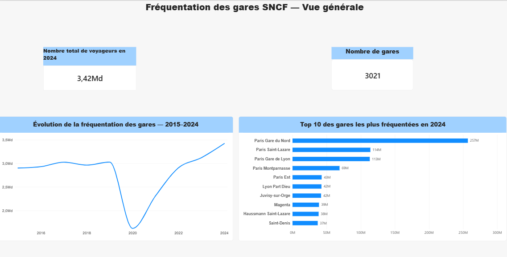
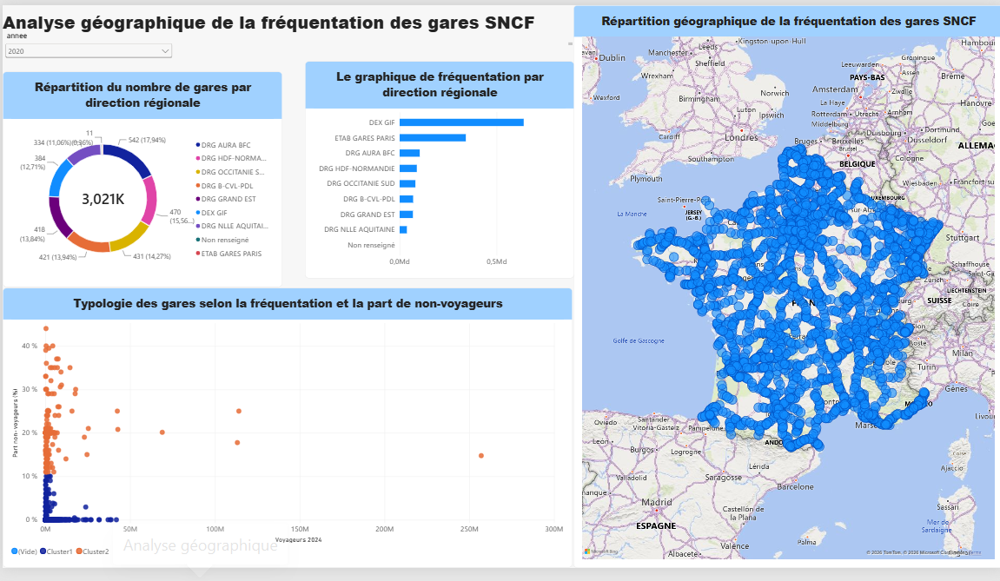
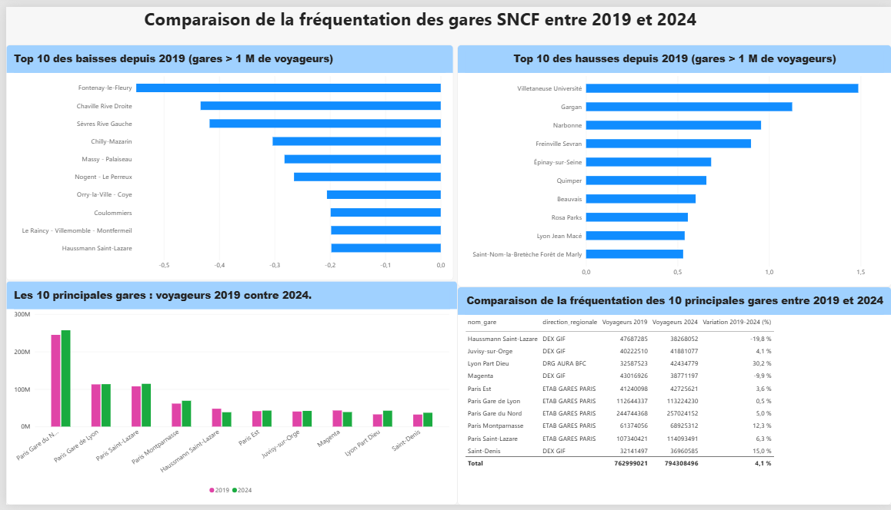
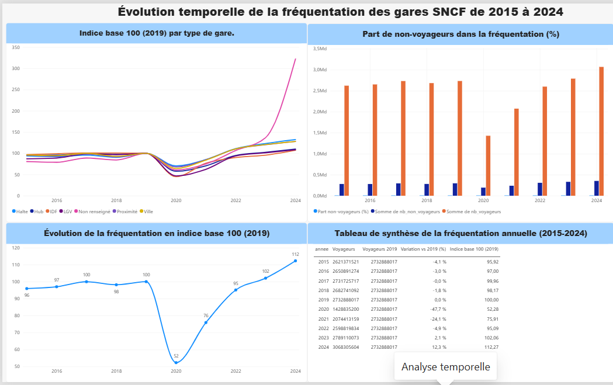

# Analyse de la fréquentation des gares SNCF

## Présentation du projet

Ce projet consiste à analyser les données de fréquentation des gares SNCF afin d'étudier l'évolution du nombre de voyageurs et de comparer la fréquentation entre les différentes gares.

Les données ont été téléchargées depuis la plateforme Open Data (data.gouv.fr).

## Objectifs du projet

- Étudier l'évolution de la fréquentation des gares selon les années.
- Identifier les gares les plus et les moins fréquentées.
- Comparer la fréquentation entre les différentes gares.
- Mettre en évidence les principales tendances à travers des visualisations.

## Outils utilisés

- **Navicat :** importation et gestion des données.
- **MySQL :** création de la base de données et nettoyage des données.
- **SQL :** contrôle des valeurs manquantes, recherche des doublons et vérification de la qualité des données.
- **Power BI :** création de graphiques, d'une carte et d'un tableau de bord interactif.

## Étapes de réalisation

1. Téléchargement des fichiers depuis data.gouv.fr.
2. Création de la base de données `sncf_frequentation_bdd`.
3. Importation des données dans MySQL avec Navicat.
4. Création et organisation des tables Gares et Fréquentation.
5. Nettoyage et vérification des données avec des requêtes SQL.
6. Connexion de la base MySQL à Power BI.
7. Création de visualisations pour analyser les résultats.

## Résultat attendu

Un tableau de bord interactif permettant de visualiser et de mieux comprendre la fréquentation des gares SNCF.

## Compétences développées

Gestion de bases de données, nettoyage des données, requêtes SQL, analyse de données et visualisation avec Power BI.

## Présentation du tableau de bord Power BI

### 1. Vue générale de la fréquentation des gares SNCF

Cette vue générale présente les principaux indicateurs de fréquentation des gares SNCF. Elle permet d'avoir une vision globale des données et de mieux comprendre la répartition du nombre de voyageurs.

### 2. Les stations les plus fréquentées

Ce graphique permet d'identifier et de comparer les stations qui accueillent le plus grand nombre de voyageurs. Il met en évidence les gares les plus fréquentées.

## 3. Analyse comparative de la fréquentation des gares SNCF entre 2019 et 2024

### 3.1 Top 10 des baisses depuis 2019 (gares de plus d'un million de voyageurs)

Ce graphique identifie les 10 gares ayant enregistré les plus fortes baisses de fréquentation entre 2019 et 2024.

### 3.2 Top 10 des hausses depuis 2019 (gares de plus d'un million de voyageurs)

Ce graphique présente les 10 gares ayant connu les plus fortes augmentations de fréquentation entre 2019 et 2024.

### 3.3 Les 10 principales gares en nombre de voyageurs

Ce graphique met en évidence les 10 gares les plus fréquentées en France en 2024, selon leur nombre total de voyageurs.

### 3.4 Évolution de la fréquentation des gares entre 2019 et 2024

Ce graphique permet de comparer la fréquentation des gares sur les deux années et d'observer les principales tendances d'évolution du trafic ferroviaire.

## 4. Analyse temporelle de la fréquentation des gares SNCF (2015-2024)

Cette partie présente l'évolution de la fréquentation des gares SNCF sur une période de dix ans, de 2015 à 2024, à travers quatre indicateurs :

### 4.1 Évolution temporelle de la fréquentation des gares SNCF de 2015 à 2024

Ce graphique permet de suivre l'évolution du nombre de voyageurs dans les gares sur dix ans.

### 4.2 Indice base 100 (2019) par type de gare

Ce graphique compare l'évolution de la fréquentation selon le type de gare, en prenant l'année 2019 comme année de référence.

### 4.3 Part de non-voyageurs dans la fréquentation (%)

Cet indicateur permet d'observer la proportion de non-voyageurs dans la fréquentation des gares.

### 4.4 Évolution de la fréquentation en indice base 100 (2019)

Ce graphique met en évidence les variations de fréquentation par rapport à l'année de référence 2019.

### 4.5 Tableau de synthèse de la fréquentation annuelle (2015-2024)

Ce tableau récapitule les données de fréquentation annuelle afin de faciliter la comparaison entre les différentes années.

